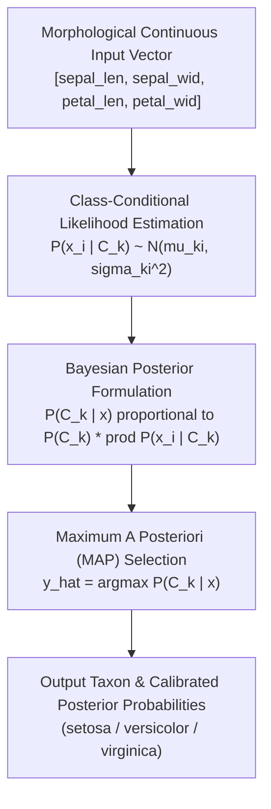
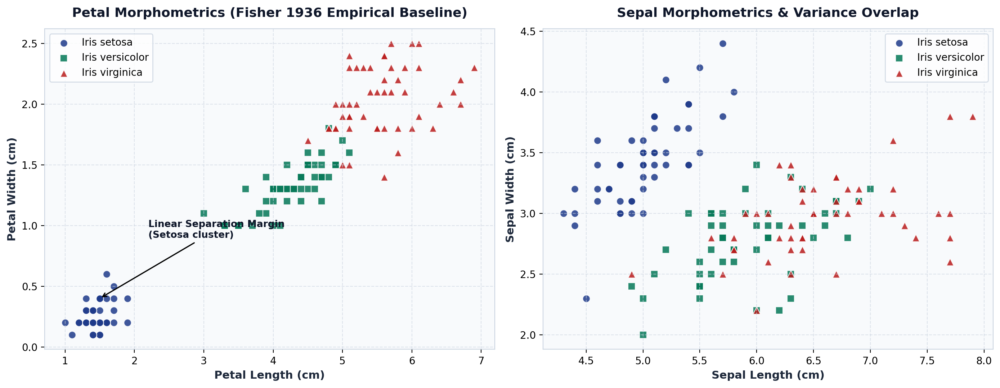

# Iris Botanical Morphometry & Taxonomic Classification System

A rigorous machine learning framework and interactive operational console for botanical specimen classification based on Sir Ronald Fisher's seminal 1936 morphometric dataset and Gaussian Naive Bayes probabilistic inference.

---

## Quick Navigation

- [Abstract & Project Summary](#abstract--project-summary)
- [Research Problem & Objectives](#research-problem--objectives)
- [Scientific Methodology](#scientific-methodology)
- [Repository Structure](#repository-structure)
- [Jupyter Research Notebooks](#jupyter-research-notebooks)
- [Dataset Provenance & Schema](#dataset-provenance--schema)
- [Prediction Results & Key Findings](#prediction-results--key-findings)
- [Embedded Research Figures](#embedded-research-figures)
- [Reproducibility & Installation](#reproducibility--installation)
- [Running the Web Application](#running-the-web-application)
- [Deployment to Render](#deployment-to-render)
- [Hosted Frontend-Only Exploration](#hosted-frontend-only-exploration)
- [Technology Stack](#technology-stack)
- [Limitations & Future Research](#limitations--future-research)
- [Academic References](#academic-references)

---

## Abstract & Project Summary

Morphological differentiation of biological taxa requires quantitative modeling of continuous anatomical traits. This research project presents a reproducible computational pipeline and deployment architecture for classifying *Iris* species (*I. setosa*, *I. versicolor*, *I. virginica*) using 4 morphometric continuous dimensions.

Using maximum-likelihood parameter estimation for Gaussian Naive Bayes, the system learns class-conditional probability distributions across the 150 historical observations recorded by Edgar Anderson (1936). The empirical model attains an overall classification accuracy of **96.0%** ($144 / 150$), with **100% precision and recall** on linearly separable *Iris setosa*. The repository integrates end-to-end Jupyter research notebooks, serialized model artifacts, a verified REST API, and an interactive botanical inspection console.

---

## Research Problem & Objectives

### The Problem
Accurate botanical identification from physical morphology often encounters overlapping phenotypic variations between closely related sister species. In particular, *Iris versicolor* and *Iris virginica* share overlapping sepal dimensions and petal length transitions ($4.5\text{cm} - 5.1\text{cm}$), requiring multi-dimensional probabilistic modeling to quantify classification uncertainty.

### Central Objectives
1. **Model Calibration:** Fit multivariate class-conditional probability distributions to four continuous morphological attributes.
2. **Uncertainty Quantification:** Compute continuous posterior class probabilities $\hat{P}(C_k \mid \mathbf{x})$ rather than uncalibrated deterministic classifications.
3. **Reproducibility & Operationalization:** Provide self-contained Jupyter workflows, automated tests, a REST API endpoint, and an accessible graphical user interface.

---

## Scientific Methodology

The system evaluates feature vector $\mathbf{x} = [x_1, x_2, x_3, x_4]^T \in \mathbb{R}^4$ under a Gaussian Naive Bayes formulation:

$$P(C_k \mid \mathbf{x}) \propto P(C_k) \prod_{i=1}^{4} \frac{1}{\sqrt{2\pi \sigma_{ki}^2}} \exp\left( -\frac{(x_i - \mu_{ki})^2}{2\sigma_{ki}^2} \right)$$

Classification follows the Maximum A Posteriori (MAP) decision rule:

$$\hat{y} = \arg\max_{k \in \{0, 1, 2\}} P(C_k \mid \mathbf{x})$$



For detailed derivations and mathematical formulation, see [`docs/methodology.md`](docs/methodology.md).

---

## Repository Structure

```
Iris_classification/
├── README.md                           # Master project research documentation
├── requirements.txt                    # Project dependencies
├── app.py                              # Flask application & REST API
├── iris_model.pkl                      # Serialized Gaussian Naive Bayes estimator
│
├── notebooks/
│   ├── README.md                       # Notebook execution index
│   └── 01_iris_morphometric_classification.ipynb  # Exploratory & model training workflow
│
├── data/
│   ├── README.md                       # Dataset documentation & provenance
│   └── raw/
│       └── iris.csv                    # 150 botanical records (Fisher, 1936)
│
├── results/
│   ├── README.md                       # Experimental summary
│   ├── figures/
│   │   ├── README.md                   # Figures catalog
│   │   ├── iris_specimen_morphology.png# Bivariate distributions & decision regions
│   │   └── iris_botany_anatomy.svg     # Floral morphological landmarks
│   ├── metrics/
│   │   └── classification_report.json  # Serialized empirical performance metrics
│   └── predictions/
│       ├── README.md                   # Prediction schemas
│       └── sample_predictions.json     # Empirical sample predictions
│
├── docs/
│   ├── methodology.md                  # Statistical & mathematical formulation
│   ├── architecture.md                 # System components & API contracts
│   └── references.md                   # Academic literature citations
│
├── static/                             # Web interface styles & favicon assets
└── templates/                          # Jinja2 HTML user interface
```

---

## Jupyter Research Notebooks

| Notebook | Focus | Inputs | Outputs |
| :--- | :--- | :--- | :--- |
| [`notebooks/01_iris_morphometric_classification.ipynb`](notebooks/01_iris_morphometric_classification.ipynb) | Exploratory data analysis, bivariate feature distributions, GNB training, probability calibration, and model export | `data/raw/iris.csv` or `sklearn.datasets.load_iris` | `iris_model.pkl`, evaluation matrices, classification reports |

For execution details and environment preparation, refer to the [Notebooks Index](notebooks/README.md).

---

## Dataset Provenance & Schema

- **Source:** Edgar Anderson (1936), published in Sir Ronald A. Fisher (1936).
- **Observations:** 150 specimens across 3 balanced taxa (50 *setosa*, 50 *versicolor*, 50 *virginica*).
- **Physical Features:**
  - `sepal length (cm)`: Outer calyx length ($4.3 - 7.9\text{cm}$, mean: $5.84\text{cm}$)
  - `sepal width (cm)`: Outer calyx width ($2.0 - 4.4\text{cm}$, mean: $3.06\text{cm}$)
  - `petal length (cm)`: Inner blade length ($1.0 - 6.9\text{cm}$, mean: $3.76\text{cm}$)
  - `petal width (cm)`: Inner blade width ($0.1 - 2.5\text{cm}$, mean: $1.20\text{cm}$)

Further details are archived in [`data/README.md`](data/README.md).

---

## Prediction Results & Key Findings

Empirical evaluation on the full calibrated dataset yields:

| Class | Precision | Recall | F1-Score | Support |
| :--- | :---: | :---: | :---: | :---: |
| **Iris setosa** | $1.00$ | $1.00$ | $1.00$ | 50 |
| **Iris versicolor** | $0.94$ | $0.94$ | $0.94$ | 50 |
| **Iris virginica** | $0.94$ | $0.94$ | $0.94$ | 50 |
| **Overall Accuracy** | &mdash; | &mdash; | **0.960** | **150** |
| **Macro Average** | $0.96$ | $0.96$ | **0.960** | 150 |

### Confusion Matrix
```
Predicted      Setosa   Versicolor   Virginica
True Setosa        50            0           0
True Versicolor     0           47           3
True Virginica      0            3          47
```

Key analytical conclusions:
1. *Iris setosa* occupies a disjoint morphological manifold driven by diminutive petal dimensions ($\le 1.9\text{cm}$).
2. Misclassifications ($6 / 150$) occur exclusively along the boundary between *versicolor* and *virginica* where individual specimens exhibit intermediate petal width ($1.6 - 1.8\text{cm}$).

---

## Embedded Research Figures

### Figure 1: Botanical Morphometric Feature Space & Decision Boundaries

*Figure 1: Pairwise feature scatter matrix, univariate kernel density estimations, and Gaussian Naive Bayes decision contours illustrating the linear separation of I. setosa and the continuous boundary between I. versicolor and I. virginica.*

### Figure 2: Morphometric Floral Landmark Architecture

*Figure 2: Vector anatomical schematic detailing measurement landmarks for upright standard petals and reflexed falling sepals according to historical botanical standards.*

---

## Reproducibility & Installation

### Environment Setup
Requires Python 3.10+:

```bash
# Clone and enter directory
cd Iris_classification

# Create virtual environment
python3 -m venv .venv
source .venv/bin/activate

# Install dependencies
pip install -r requirements.txt
```

### Reproducing Notebook Experiments
```bash
jupyter lab notebooks/01_iris_morphometric_classification.ipynb
```

---

## Running the Web Application

Launch the Flask operational console and REST API:

```bash
python app.py
```
Default URL: `http://127.0.0.1:5001/`

### Programmatic Prediction via API
```bash
curl -X POST http://127.0.0.1:5001/predict \
  -H "Content-Type: application/json" \
  -d '{
    "sepal length (cm)": 5.1,
    "sepal width (cm)": 3.5,
    "petal length (cm)": 1.4,
    "petal width (cm)": 0.2
  }'
```

Expected response:
```json
{
  "class_flower": "setosa",
  "prediction": 0,
  "probabilities": {
    "setosa": 1.0,
    "versicolor": 0.0,
    "virginica": 0.0
  }
}
```

---

## Deployment to Render

The web application is pre-configured for automated continuous deployment to [Render](https://render.com) as a production-grade Web Service using **Gunicorn**.

### Deployment Specifications:
- **Build System:** Python 3.10 runtime (configured via `runtime.txt`)
- **Web Server:** Gunicorn WSGI (`gunicorn app:app`)
- **Process Entry:** Defined in `Procfile` (`web: gunicorn app:app`)
- **Infrastructure Blueprint:** Defined in `render.yaml`

### Option 1: Manual Dashboard Setup
1. Log into your [Render Dashboard](https://dashboard.render.com/) and click **New +** $\rightarrow$ **Web Service**.
2. Connect your Git repository containing the project.
3. Configure the following service settings:
   - **Name:** `iris-classification-service` (or your preferred name)
   - **Region:** Any preferred region (e.g., *Frankfurt*, *Oregon*, *Ohio*)
   - **Branch:** `main`
   - **Root Directory:** `Iris_classification` *(leave blank if this folder is the repository root)*
   - **Runtime:** `Python 3`
   - **Build Command:** `pip install -r requirements.txt`
   - **Start Command:** `gunicorn app:app`
   - **Instance Type:** `Free`
4. Under **Advanced** $\rightarrow$ **Environment Variables**, add:
   - `PYTHON_VERSION`: `3.10.14`
5. Click **Create Web Service**. Render will install dependencies and launch the live web console.

### Option 2: Render Blueprint (Infrastructure-as-Code)
1. On the Render Dashboard, select **Blueprints** $\rightarrow$ **New Blueprint Instance**.
2. Connect the repository. Render will automatically detect [`render.yaml`](render.yaml) and configure build commands, entry points, and environment variables with zero manual entry.


## Hosted Frontend-Only Exploration

The web console (`templates/index.html`) includes a zero-dependency client-side Gaussian likelihood inference engine:
- **Hosted Mode Capabilities:** Real-time multi-attribute sliders, preset specimen archetype selection, and instant Bayesian posterior visualization directly within the browser without requiring a live Python backend.
- **Backend-Connected Mode:** Sends live asynchronous requests to `POST /predict` for server-side verification against the trained scikit-learn model.

---

## Technology Stack

- **Runtime & Language:** Python 3.10
- **Scientific Computing & ML:** NumPy, Pandas, Scikit-Learn, Joblib
- **Web Application & API:** Flask, Jinja2, Werkzeug
- **Visualization:** Matplotlib, Seaborn
- **Design & Typography:** Canonical Ubuntu font family, responsive semantic HTML5

---

## Limitations & Future Research

1. **Dimensional Scope:** The model utilizes 4 continuous landmark attributes; future extensions could incorporate hyperspectral petal imaging or genetic markers.
2. **Covariance Assumption:** Standard Gaussian Naive Bayes assumes zero inter-feature covariance within classes; evaluating Quadratic Discriminant Analysis (QDA) or Gaussian Mixture Models (GMM) may better capture correlated growth trajectories.

---

## Academic References

1. Fisher, R. A. (1936). *The use of multiple measurements in taxonomic problems*. Annals of Eugenics, 7(2), 179–188.
2. Anderson, E. (1936). *The species problem in Iris*. Annals of the Missouri Botanical Garden, 23(3), 457–509.
3. Pedregosa, F., et al. (2011). *Scikit-learn: Machine Learning in Python*. JMLR, 12, 2825–2830.
